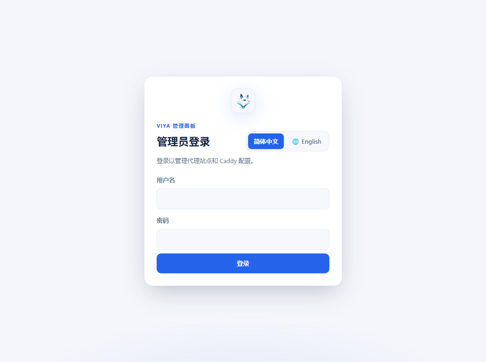
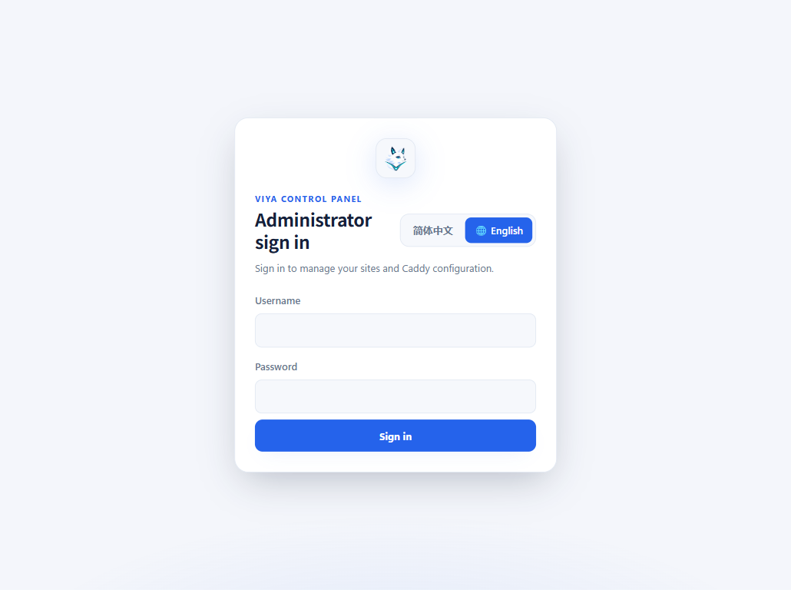
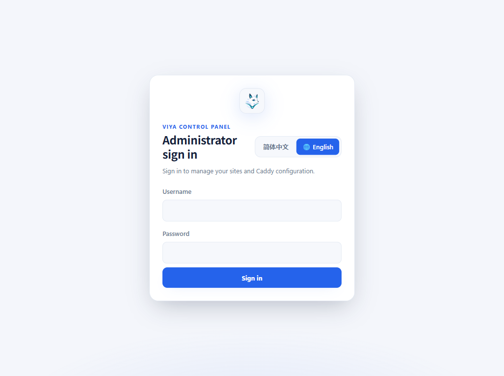
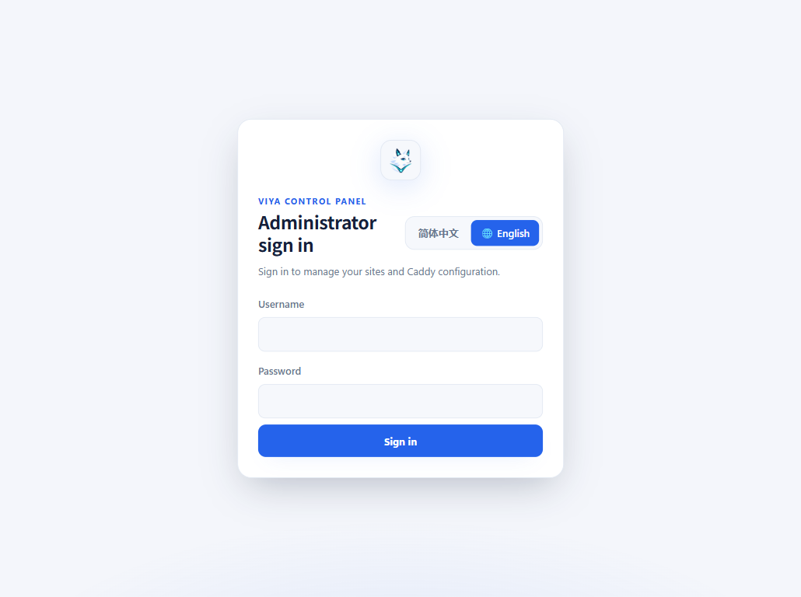
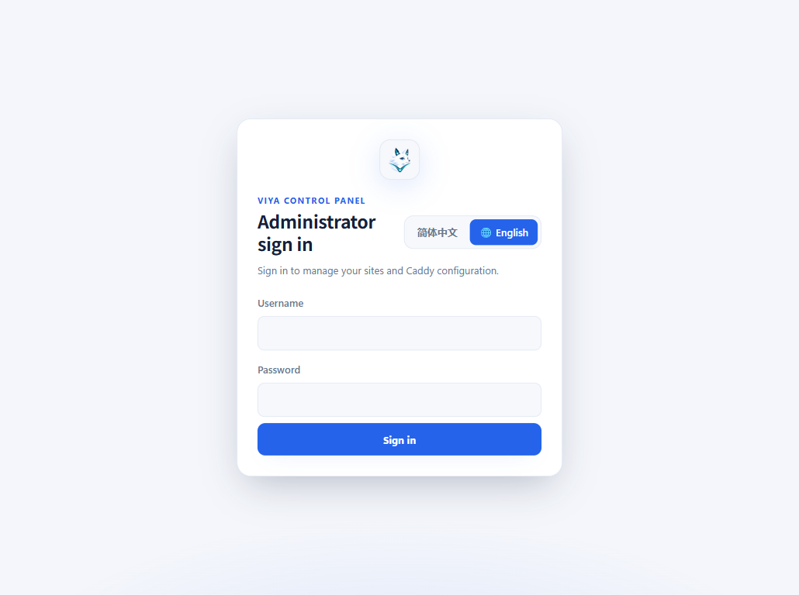
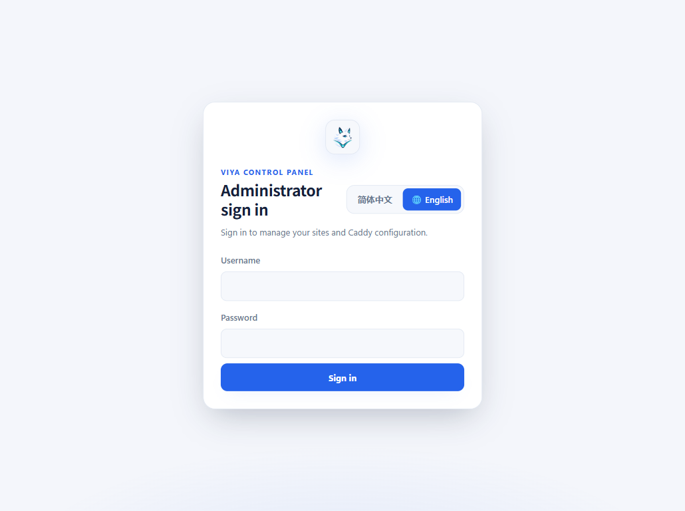

# Viya

<p align="center"></p>

<p align="center"><strong>自托管的 Caddy 可视化管理面板</strong><br>一个界面管理反向代理、静态网站、重定向、SSL 证书、动态 DNS 和 TCP/UDP 转发。</p>

<p align="center">简体中文 | <a href="README.en.md">English</a></p>

## 界面预览

以下截图来自当前源码的本地预览环境，包含演示配置。



| Web 服务 | 端口转发 |
| --- | --- |
|  |  |

| 动态 DNS | SSL 证书 |
| --- | --- |
|  |  |

| DNS 凭据 | IP 封禁 |
| --- | --- |
|  |  |

| 日志 | 配置历史 |
| --- | --- |
|  |  |

## 主要功能

- **Web 服务**：反向代理、静态网站、URL 重定向；按 HTTP/HTTPS 监听分类，支持克隆、启停、路径和安全策略。
- **静态文件**：上传和管理网站文件；删除站点时默认同时删除托管文件，也可选择保留。
- **SSL 证书**：自动申请与续期、上传自定义证书、复用匹配的泛域名证书，显示申请状态。
- **动态 DNS**：支持 A、AAAA、CNAME，选择网卡地址或公网 IP 获取方式，自动或手动更新。
- **DNS 凭据**：支持 Cloudflare、DNSPod、阿里云等服务商，凭据加密存储。
- **端口转发**：TCP、UDP 或双协议转发，端口冲突检查和流量统计。
- **访问安全**：IP/CIDR 封禁、访问控制、登录限流、默认安全配置和响应安全头。
- **运行维护**：CPU、内存、磁盘监控，流量趋势、访问日志、程序日志、配置历史及恢复。
- **面板设置**：账户、角色、语言、主题和面板端口；支持中文和英文。

## Linux 一键安装

支持运行 systemd 的 Linux，提供 amd64、arm64、armv7 安装包。

```sh
curl -fsSL https://raw.githubusercontent.com/ringer520/viya-proxy/main/install.sh | sudo sh
```

安装器会校验 SHA-256、检查端口、创建系统服务并设置开机自启。默认通过 `http://服务器局域网IP:8181` 打开面板，首次访问时创建管理员账户。面板端口应仅向可信网络开放；有防火墙时允许局域网访问对应 TCP 端口。

新安装时如端口冲突，可指定其他端口：

```sh
curl -fsSL https://raw.githubusercontent.com/ringer520/viya-proxy/main/install.sh | sudo env VIYA_INSTALL_LISTEN=0.0.0.0:8182 sh
```

```sh
sudo systemctl status viya
sudo journalctl -u viya -f
sudo systemctl restart viya
```

## Docker 安装

只需将一个宿主机目录映射到 `/var/lib/viya`，数据库、证书、网站文件、日志及加密密钥均保存在其中。

```sh
sudo mkdir -p /opt/viya/data
cd /opt/viya
```

保存以下内容为 `compose.yaml`：

```yaml
services:
  viya:
    image: ringer520/viya-proxy:latest
    container_name: viya
    restart: unless-stopped
    ports:
      - "8181:8181"
      - "80:80"
      - "443:443"
      - "443:443/udp"
    volumes:
      - /opt/viya/data:/var/lib/viya
```

```sh
sudo docker compose up -d
sudo docker compose logs -f viya
```

打开 `http://服务器局域网IP:8181`。如宿主机端口被占用，可将映射左侧改为其他端口，例如 `18181:8181`。HTTP-01 证书验证需要公网 80 端口可达；无法提供时可使用 DNS-01。HTTPS 默认使用 TCP 443，HTTP/3 使用 UDP 443。

更新镜像：

```sh
sudo docker compose pull
sudo docker compose up -d
```

升级前停止容器并备份完整 `/opt/viya/data` 目录。务必保存原有 `master.key`，否则已有 DNS 凭据无法解密。旧版双卷安装需要先迁移密钥，具体步骤见 [英文安装与升级说明](README.en.md#migrating-from-the-previous-two-volume-docker-setup)。

## 备份与恢复

systemd 安装包包含备份和恢复脚本：

```sh
sudo sh ./scripts/backup-linux.sh
sudo sh ./scripts/restore-linux.sh /var/backups/viya/viya-YYYYMMDDTHHMMSSZ.tar.gz
```

Linux 脚本备份不包含主密钥，请另外保存 `/etc/viya/secrets/master.key`。面板配置导出使用密码加密，包含业务配置，不包含账户和会话。

## 从源码构建

需要 Go 1.27+、Node.js 22 和 pnpm。前端内嵌于 Viya，运行时无需 Node.js 或外部数据库；Viya 与自定义 Caddy 是两个二进制程序。

```powershell
pnpm --dir web install --frozen-lockfile
./scripts/build-linux.ps1
```

输出位于 `bin/`。本地预览可使用 `scripts/start-local-preview.ps1 -Build`，预览数据保存在 `.preview/`。

推送 `v*` 标签会自动生成 Linux Release 安装包、校验文件及多架构 Docker 镜像。每个版本的更新说明位于 `docs/releases/<版本号>.md`，发布时会写入 GitHub Release。

## 协议

[MIT License](LICENSE)
