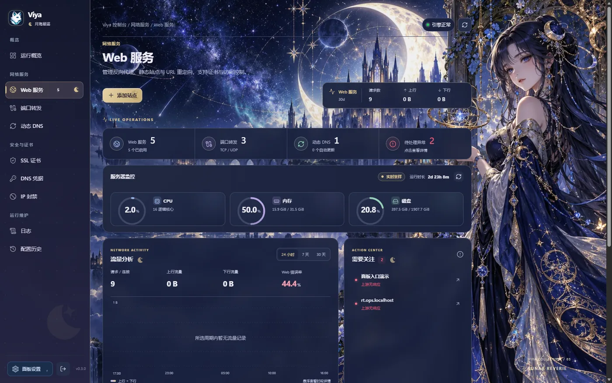
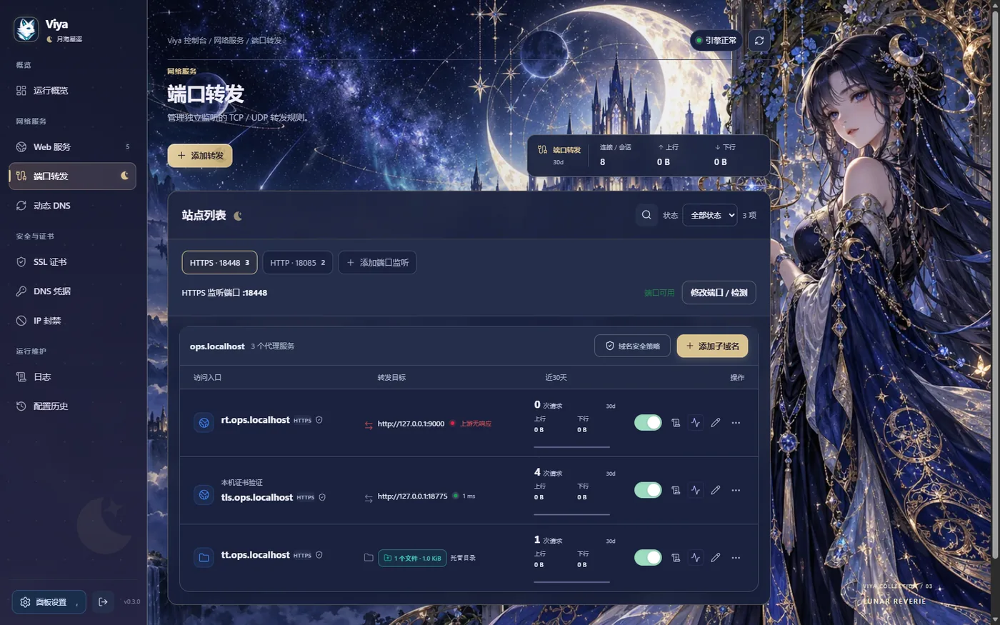
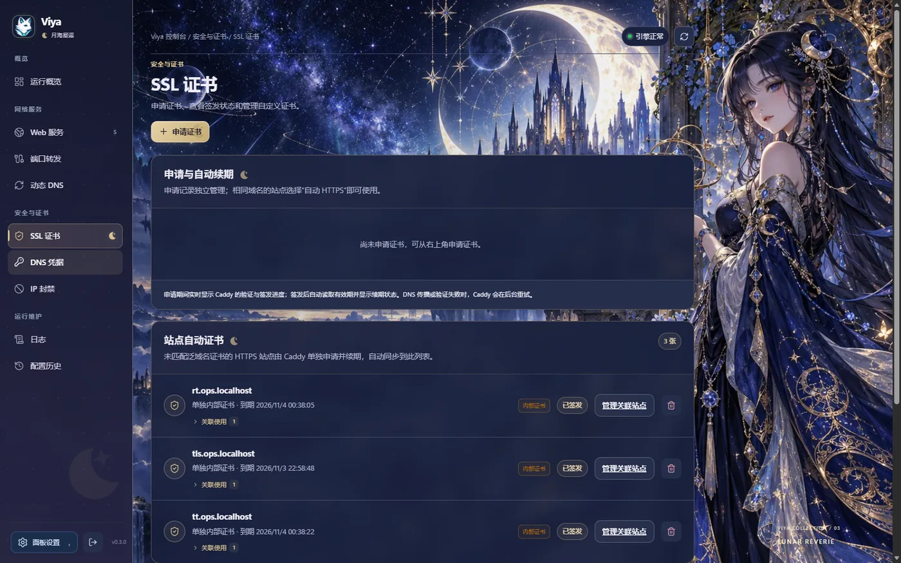
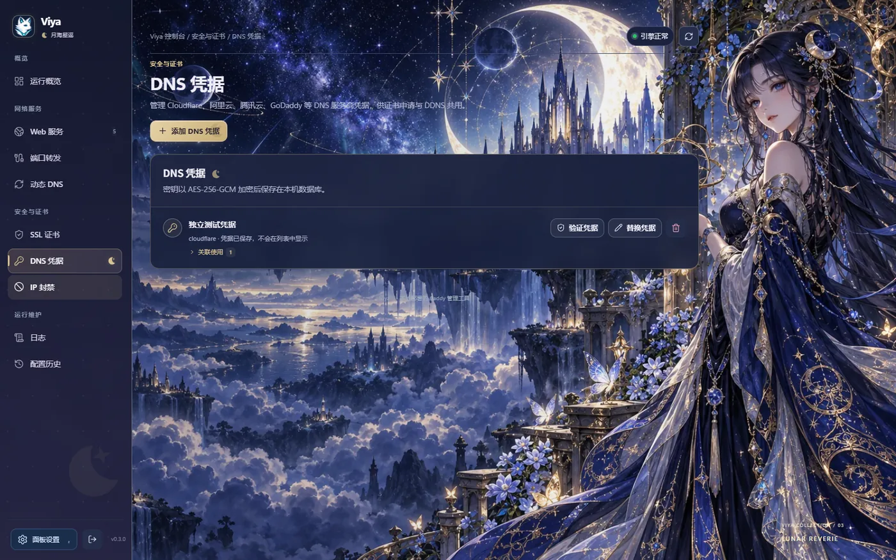
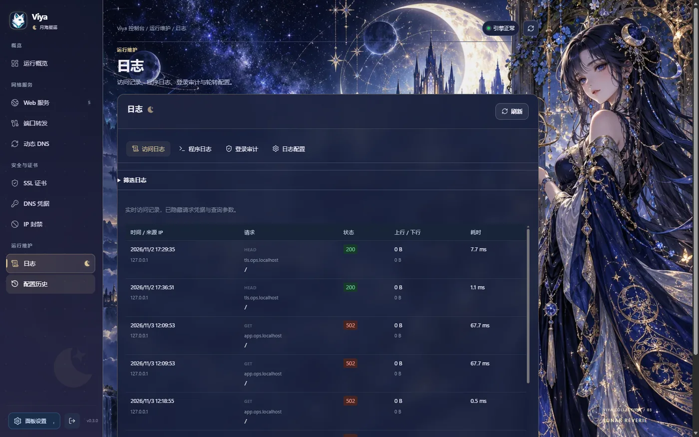

# Viya

<p align="center"></p>

<p align="center"><strong>自托管的 Caddy 可视化管理面板</strong><br>反向代理、静态网站、TLS 证书、动态 DNS 与 TCP/UDP 转发，一个控制台管完。</p>

<p align="center">简体中文 · <a href="README.en.md">English</a></p>

<p align="center">
  <a href="https://github.com/ringer520/viya-proxy/releases/latest"></a>
  <a href="https://hub.docker.com/r/ringer520/viya-proxy"></a>
  <a href="LICENSE"></a>
</p>

<p align="center"><a href="https://viya.861010.xyz">官网 · viya.861010.xyz</a></p>

**目录**：[快速开始](#快速开始) · [安全提示](#安全提示) · [功能概览](#功能概览) · [界面预览](#界面预览) · [安装](#安装) · [备份与恢复](#备份与恢复) · [从源码构建](#从源码构建) · [卸载](#卸载) · [文件服务权限](docs/文件服务权限.md)

## 快速开始

```sh
curl -fsSL https://raw.githubusercontent.com/ringer520/viya-proxy/main/install.sh | sh
```

安装完成后打开 `http://服务器IP:8181`，首次访问创建管理员账号。支持 systemd Linux 与 OpenWrt，提供 amd64 / arm64 / armv7 版本；Docker 见[安装](#安装)。

> [!IMPORTANT]
> 面板默认监听 `0.0.0.0:8181`，首个管理员可从任何能访问面板的 IP 创建。**在 VPS 或任何公网可达的机器上，先读[安全提示](#安全提示)再初始化。**

## 安全提示

Viya 管着域名、证书和全部流量。默认配置偏保守，但有三件事只能由你确认。

### 初始化之前

- **不要把未初始化的面板暴露到公网。** 首次创建管理员不校验来源，谁先打开谁就是管理员。
- **VPS 上安装时就把面板绑到回环**，初始化走 SSH 隧道：

```sh
# 服务器上安装，面板只监听本机
VIYA_INSTALL_LISTEN=127.0.0.1:8181 sh install.sh

# 本地建立隧道后访问 http://127.0.0.1:8181
ssh -L 8181:127.0.0.1:8181 root@你的服务器
```

### 配好 HTTPS 之后

打开 **面板设置 → 访问与安全 → 禁止从公网用 IP 打开面板**。开启后：

| 访问方式 | 结果 |
| --- | --- |
| 反代到面板的域名 | 放行（从站点表自动识别，不用手填） |
| 局域网 IP | 放行 |
| 公网 IP、未登记的域名 | 403，且在登录之前就拒绝 |
| 本机 / SSH 隧道 | 放行，用于误配置后恢复 |

需要更严的控制时，展开同一张卡片里的「高级」：指定允许的域名、来源网段、强制 HTTPS 跳转。

<details>
<summary>防呆机制与恢复方式</summary>

保存时会用你当前这次请求回放新规则。如果新规则会把你锁在外面，保存直接被拒绝并给出提示，而不是保存成功后再也进不来。

真的锁住了，SSH 进去删规则即可：

```sh
python3 -c "
import sqlite3
c = sqlite3.connect('/var/lib/viya/viya.db')
c.execute(\"DELETE FROM panel_settings WHERE key='panel_access'\")
c.commit()"
sudo systemctl restart viya
```

本机发起连接的判定要求「连接方」和「解析后的真实客户端」同时是本机。只信任连接方会让 Caddy 反代后的所有请求都被当成来自 `127.0.0.1`，规则形同失效；`X-Forwarded-For` 仅在来源属于 `VIYA_TRUSTED_PROXIES` 时采信。

</details>

### 始终要做的

- **主密钥单独保管。** `/etc/viya/secrets/master.key` 决定 DNS 凭据能否解密。它和备份放在一起，等于没有加密。
- **配置导出含业务凭据与证书**，不要公开分享。
- **反代到面板的机器必须写进 `VIYA_TRUSTED_PROXIES`。** 否则所有访客看起来是同一个 IP，登录限流、地区封禁、审计日志会一起失真；勾了「强制 HTTPS」还会 308 循环。
- **服务器文件服务默认只读**，可见范围由运行用户与 systemd 限制决定。授权方式见[文件服务权限范围](docs/文件服务权限.md)。

## 功能概览

| 能力 | 说明 |
| --- | --- |
| Web 服务 | 反向代理、静态站点、URL 重定向；按 HTTP/HTTPS 监听管理，支持路径匹配、上游调优、克隆与启停 |
| TLS 证书 | 申请与自动续期、进度查看、自定义上传；站点可复用匹配的泛域名证书 |
| 动态 DNS | A / AAAA / CNAME；跟随网卡或固定地址，定时与手动更新 |
| DNS 凭据 | Cloudflare、DNSPod、阿里云等；凭据用独立主密钥加密存储 |
| TCP / UDP 转发 | 单协议或双协议规则，与 Web 服务分别统计近 30 天连接与流量 |
| 访问安全 | IP/CIDR 封禁、访问控制、登录限流、自动封禁、安全响应头 |
| 运行维护 | 资源监控、访问日志、程序日志、流量趋势、配置历史、备份与恢复 |
| 账户与界面 | 管理员与只读账号、中英文、五套基础主题与三套二次元主题 |
| 文件 | 站点文件管理（上传、编辑、重命名、删除）；服务器文件服务默认隐藏且只读 |

<details>
<summary>操作状态的含义</summary>

界面会把「配置成功」和「实际生效」分开显示，避免把保存成功当成服务可用。

- 端口转发分别展示配置启停与实际监听核实结果；监听正常不等于上游业务正常。
- DDNS 分阶段展示获取地址、比较、提交与服务商回读，分别记录检查时间和实际修改时间。IPv6 可选跟随网卡或固定地址；固定地址失效不会被静默替换。
- SSL 证书关联使用情况显示在每项信息末行；站点诊断可检查完整访问链路。
- DNS 凭据的只读验证通过，不代表具有写入权限。
- IP 规则分手动、地区与自动封禁，可查询某地址命中的规则。修改面板自身的限制需在 120 秒内通过对应域名确认，否则自动恢复原规则；局域网入口可以取消。
- 日志支持站点、关键词、时间与状态筛选，查询范围为当前文件尾部最多 2 MiB；配置历史保留最近 10 条操作摘要与操作者。
- 地区限制按连接到 Caddy 的来源地址判断。使用 CDN 或其他代理时，代理出口可能被地区规则拦截。

</details>

## 界面预览

运行概览展示服务器资源、可切换时间范围的流量趋势和需要关注的服务状态；点击 Web 错误率可按站点和状态码定位近期异常。


<details>
<summary>展开查看其他界面</summary>

| Web 服务 | TCP / UDP 端口转发 |
| --- | --- |
|  |  |

| 动态 DNS | SSL 证书 |
| --- | --- |
|  |  |

| DNS 凭据 | IP 封禁 |
| --- | --- |
|  |  |

| 日志 | 配置历史 |
| --- | --- |
|  |  |

</details>

## 安装

### Linux（systemd）

```sh
curl -fsSL https://raw.githubusercontent.com/ringer520/viya-proxy/main/install.sh | sh
```

安装会校验 Release 包的 SHA-256、创建 systemd 服务并设置开机自启。需要 `curl` 或 `wget`、`tar`、`python3` 与系统 CA 证书，安装器会尝试用系统包管理器补齐。普通用户可执行同一命令，安装器会通过 `sudo` 重新运行。

<details>
<summary>端口冲突、防火墙与版本固定</summary>

检测到默认端口被占用时会提示选择新端口，也可显式指定：

```sh
curl -fsSL https://raw.githubusercontent.com/ringer520/viya-proxy/main/install.sh | VIYA_INSTALL_LISTEN=0.0.0.0:8182 sh
```

启用了系统防火墙时，需允许局域网访问面板 TCP 端口，以及 Web 服务端口（通常 80/443）。

固定版本安装：

```sh
curl -fsSL https://raw.githubusercontent.com/ringer520/viya-proxy/main/install.sh | VERSION=v0.4.0 sh
```

环境变量必须放在管道右侧。

</details>

<details>
<summary>服务管理与自更新</summary>

```sh
sudo systemctl status viya.service
sudo journalctl -u viya.service -f
sudo systemctl restart viya.service
```

systemd 安装可在「面板设置」中检查并执行自更新；Docker 环境通过拉取新镜像更新。

</details>

### Docker

数据库、证书、网站文件、Caddy 数据、日志与主密钥统一放在容器内 `/var/lib/viya`，建议只映射一个宿主机目录。

```sh
sudo mkdir -p /opt/viya/data && cd /opt/viya
```

```yaml
services:
  viya:
    image: ringer520/viya-proxy:latest
    container_name: viya
    restart: unless-stopped
    ports:
      - "8181:8181"       # 面板
      - "80:80"           # HTTP 网站及 HTTP-01 验证
      - "443:443"         # HTTPS 网站
      - "443:443/udp"     # HTTP/3（可选）
    volumes:
      - /opt/viya/data:/var/lib/viya
```

```sh
docker compose up -d
docker compose logs -f viya
```

访问 `http://服务器IP:8181`。更新用 `docker compose pull && docker compose up -d`。

<details>
<summary>端口冲突、证书验证与更新注意</summary>

- 面板端口冲突时改宿主机侧映射，例如 `18181:8181`。
- 宿主机的 80/443 被占用需先解决，且网站实际监听端口要与映射一致。
- HTTP-01 验证要求域名的 80 端口对公网可达，否则改用 DNS-01。
- 更新前备份 `/opt/viya/data`，并保留其中 `master.key`，否则已有 DNS 凭据无法解密。
- **不要用 `docker compose down -v` 更新**，它会删除数据卷。

</details>

### OpenWrt

支持使用 procd 的 **amd64、arm64、armv7**，不支持 MIPS。SSH 登录路由器后以 root 执行：

```sh
wget -qO- https://raw.githubusercontent.com/ringer520/viya-proxy/main/install.sh | sh
```

通用入口会识别 OpenWrt 并调用专用安装器。新安装默认访问 `http://路由器IP:8181`，数据在 `/opt/viya/data`，主密钥在 `/etc/viya/secrets/master.key`。

<details>
<summary>80 端口冲突（LuCI 占用）与高级参数</summary>

OpenWrt 的 80 端口默认由 LuCI 的 uhttpd 占用，而 Viya 的 Web 监听默认是 80/443。安装器会指出占用进程并继续安装，但在释放端口或改监听之前，**已保存的站点无法对外服务**，表现为配置应用失败。两种处理方式：

```sh
# 让 LuCI 让出 80（之后 LuCI 在 8080）
uci set uhttpd.main.listen_http='0.0.0.0:8080' '[::]:8080'
uci commit uhttpd && /etc/init.d/uhttpd restart

# 或保持 LuCI 不动，在面板「Web 服务 → 监听端口」把 80/443 改到其他端口
```

指定版本与端口：

```sh
wget -O /tmp/viya-install.sh https://raw.githubusercontent.com/ringer520/viya-proxy/main/deploy/install-openwrt.sh
VERSION=v0.4.0 VIYA_INSTALL_PORT=8181 sh /tmp/viya-install.sh
```

修改服务监听地址：

```sh
uci set viya.main.listen='0.0.0.0:8182'
uci commit viya && /etc/init.d/viya restart
logread -e viya
```

需要 `curl` 或 `wget`、`tar`、`sha256sum`、`netstat`、UCI 与 HTTPS CA 证书（opkg 系安装 `ca-bundle`，apk 系安装 `ca-certificates`）。`/opt` 必须是持久化目录或已挂载的外部存储，下载解压还需 `/tmp` 约 128 MiB 可用空间。安装器不会自动开放 WAN 端口。小内存路由器建议挂外部存储或改用独立 Linux 主机。

OpenWrt 脚本已通过 POSIX Shell 语法检查，尚未做全型号真机验证，需在实际设备确认固件、CPU、存储与网络兼容性。升级前复制数据、密钥与程序到 `/opt/viya/backups/install-*`。

</details>

## 备份与恢复

备份工具位于 `/opt/viya/scripts/`，需要 Python 3.11 或更新版本。

```sh
sh /opt/viya/scripts/backup-linux.sh
```

备份包含一致性 SQLite 副本、托管网站文件、证书与运行数据，默认**不含**主密钥和访问日志。产物在 `/var/backups/viya/`，含文件清单、SHA-256 与主密钥指纹。

<details>
<summary>完整迁移、校验、恢复与保留策略</summary>

完整迁移建议短暂停止服务并包含主密钥，脚本结束后自动恢复原先运行的服务（以 root 运行，普通用户加 `sudo`）：

```sh
VIYA_BACKUP_INCLUDE_KEY=1 VIYA_BACKUP_STOP_SERVICE=1 sh /opt/viya/scripts/backup-linux.sh
```

完整备份含账户、凭据与私钥，未额外加密，权限 `0600`，应复制到受保护的离机位置。数据目录之外的网站根目录需另行备份。

校验与恢复演练（不修改现有安装）：

```sh
sh /opt/viya/scripts/restore-linux.sh --verify /path/to/viya-backup.tar.gz
VIYA_RESTORE_KEY=1 sh /opt/viya/scripts/restore-linux.sh --dry-run /path/to/viya-backup.tar.gz
```

正式恢复完整备份时显式允许使用包内密钥；恢复普通备份则省略 `VIYA_RESTORE_KEY=1` 并提供原主密钥：

```sh
VIYA_RESTORE_KEY=1 sh /opt/viya/scripts/restore-linux.sh /path/to/viya-backup.tar.gz
```

恢复会先备份当前数据，验证后替换，并检查 Viya 与 Caddy 就绪状态；启动失败会回退数据和密钥。目标机应先安装 Viya 并使用相同数据目录，可用 `VIYA_DATA_DIR`、`VIYA_MASTER_KEY_FILE`、`VIYA_BACKUP_DIR` 指定路径。

面板中的加密配置导出不含账户、密码、会话与网站文件，但含业务凭据与证书，不应公开分享。Docker 用户应停止容器后备份整个映射目录。

在「面板设置 → 存储」可查看占用并设置统计保留策略，日志轮转在「日志」中配置。手动清理只处理过期统计、近期访问记录与过期会话，不删除网站、证书和恢复点；SQLite 空闲页会复用，不承诺文件立即缩小。

</details>

## 从源码构建

需要 Go 1.27+、Node.js 22 和 pnpm 9。前端会嵌入二进制，运行时不需要 Node.js 或外部数据库。

```sh
pnpm --dir web install --frozen-lockfile
pnpm --dir web build
go build ./cmd/viya
```

前端产物输出到 `internal/web/dist/`，该目录由构建生成、不入库。请务必先执行 `pnpm --dir web build`，否则 `go build` 会因 `go:embed` 找不到文件而失败。

<details>
<summary>Windows 打包与发布流程</summary>

```powershell
./scripts/build-linux.ps1
./scripts/package-linux.ps1
```

推送 `v*` 标签触发 GitHub Actions，构建 amd64、arm64、armv7 安装包与 SHA-256 文件，同时发布多架构 Docker 镜像。版本说明位于 `docs/releases/`，也是 GitHub Release 正文。

</details>

## 卸载

```sh
sudo systemctl disable --now viya.service
sudo rm -f /etc/systemd/system/viya.service
sudo rm -rf /etc/systemd/system/viya.service.d /opt/viya
sudo systemctl daemon-reload
```

以上保留数据库、证书、网站文件与主密钥。确认不再需要数据后，再单独删除 `/var/lib/viya`、`/etc/viya`、`/var/log/viya` 和 `/var/backups/viya`。Docker 执行 `docker compose down`，持久数据仍在 `/opt/viya/data`。

## 协议

Viya 使用 [MIT License](LICENSE)。
