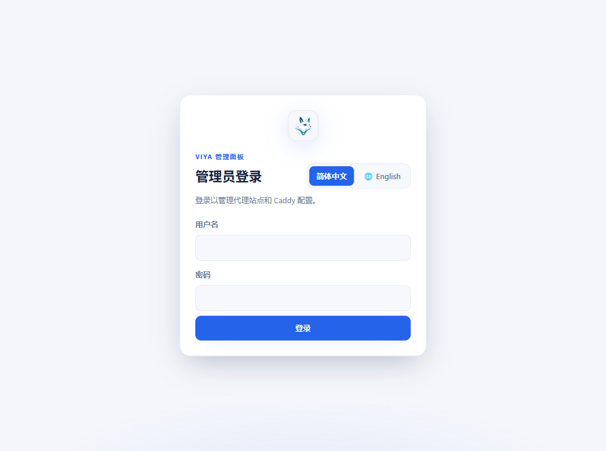
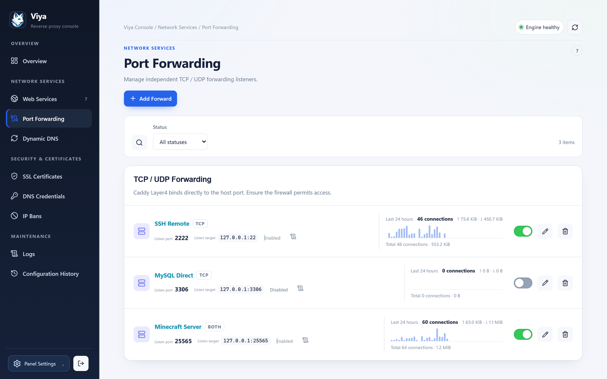
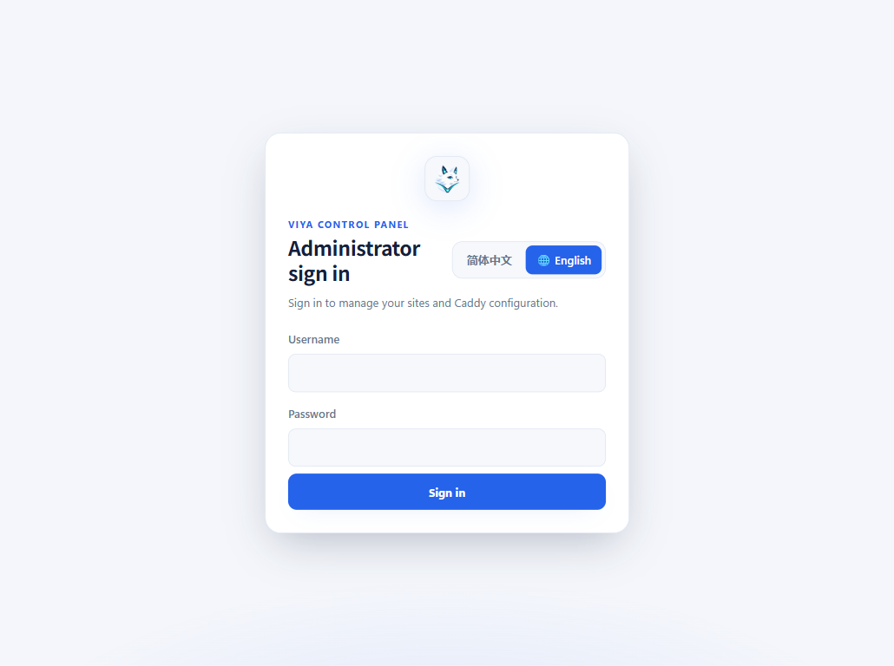
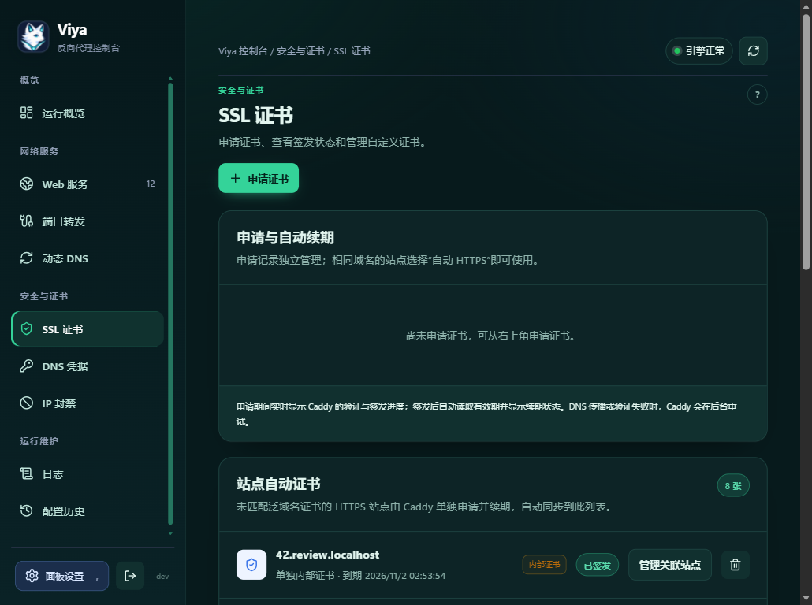
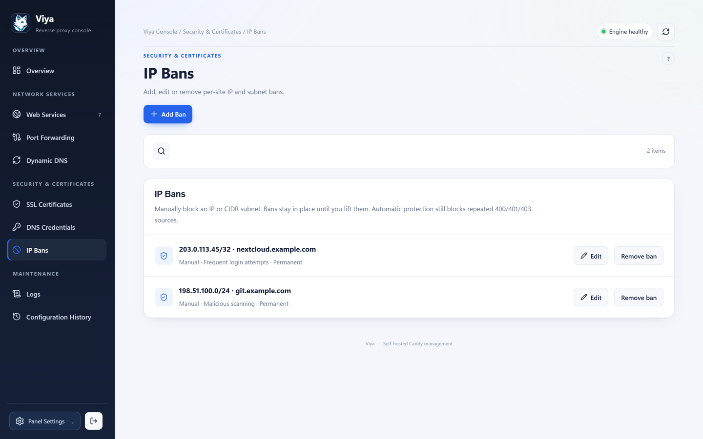
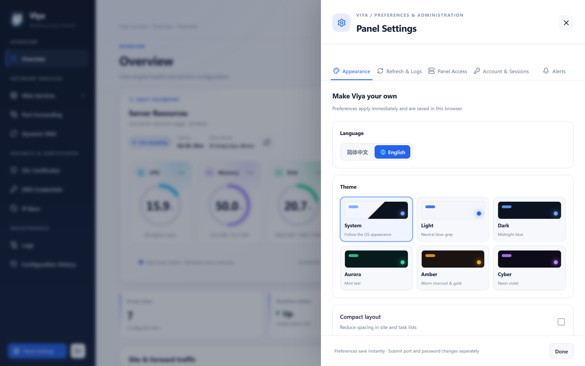
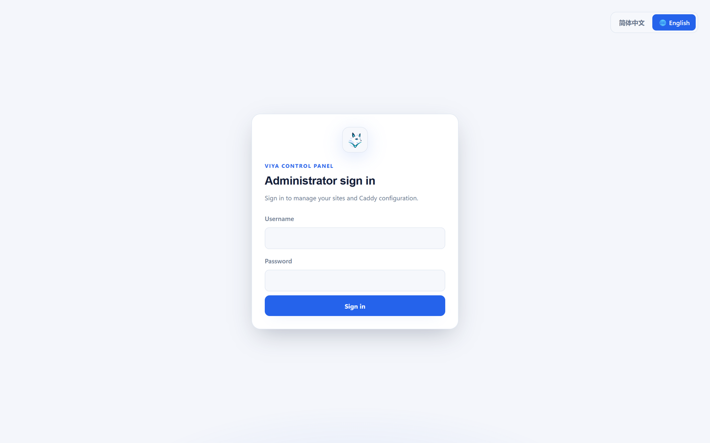

# Viya

<p align="center">
  
</p>

<p align="center">
  <strong>A self-hosted web control panel for Caddy.</strong><br>
  Manage reverse proxy sites, static websites, redirects, certificates, DNS and TCP/UDP forwarding from one interface.
</p>

<p align="center">
  <a href="https://github.com/ringer520/viya-proxy/releases"></a>
  <a href="https://github.com/ringer520/viya-proxy/blob/main/LICENSE"></a>
  <a href="https://github.com/ringer520/viya/actions/workflows/release.yml"></a>
</p>

> Viya 是一款自托管的 Caddy Web 管理面板，可在一个界面管理反向代理、静态网站、URL 重定向、证书、DNS、日志和 TCP/UDP 转发。界面支持简体中文与 English。

**Project status:** Viya is under active development. Review the release notes and keep a backup before upgrading.

## Contents

- [Screenshots](#screenshots)
- [Features](#features)
- [Quick start](#quick-start)
- [Docker](#docker)
- [Back up and restore](#back-up-and-restore)
- [Security notes](#security-notes)
- [Build from source](#build-from-source)
- [License](#license)

## Screenshots

<p align="center">
  
</p>

<details>
<summary>View more screens</summary>

| Web services | TCP/UDP forwarding |
| --- | --- |
|  |  |

| Dynamic DNS | SSL certificates |
| --- | --- |
|  |  |

| DNS credentials | IP bans |
| --- | --- |
|  |  |

| Logs | Configuration history |
| --- | --- |
|  |  |

| Panel settings | Sign in |
| --- | --- |
|  |  |

</details>

## Features

### Sites and traffic

- Create reverse proxy sites, static websites and URL redirects.
- Group sites by HTTP/HTTPS listener. Configure listener ports, check port availability and enable or disable sites individually.
- Set upstreams, paths, request headers, access rules and per-site security policies. Clone an existing site to speed up setup.
- Upload and manage static-site files from the panel. Deleting a static site also removes its managed files by default; the confirmation dialog lets you keep them.
- View traffic summaries and trends for sites and Layer 4 rules, with 24-hour, 7-day and 30-day ranges.

### Certificates and DNS

- Request and renew certificates with HTTP-01, DNS-01 or an internal CA; upload and manage custom certificates.
- Reuse a matching wildcard certificate, or request a separate certificate when there is no match. Certificate status and issuance progress are shown in the panel.
- Store DNS provider credentials for Cloudflare, DNSPod, Alibaba Cloud DNS, GoDaddy, Namecheap, DigitalOcean and Vultr. Credentials are encrypted at rest.
- Schedule DDNS updates for A, AAAA and CNAME records. Choose a public-IP lookup or a network interface address, and run an update manually when needed.

### Forwarding, security and operations

- Forward TCP, UDP or both through Caddy Layer 4, with listener conflict checks and per-rule traffic information.
- Manage manual IP/CIDR bans, block addresses classified as outside mainland China, and enable automatic temporary bans for repeated suspicious requests. The geographic rule uses approximate APNIC allocation data; behind a CDN or proxy, Viya evaluates the connecting proxy address.
- Configure global and domain-level security defaults, then inherit or override them per site. Options include IP access rules, basic authentication, rate limits, allowed methods, request-size limits and response headers.
- Review access logs, program logs and login audit records. Configure log level and retention limits.
- Monitor Caddy and upstream health, CPU, memory, disk use, certificate expiry and traffic trends. Optional webhook notifications report operational events.
- Inspect configuration history and diffs. Export or import an encrypted configuration archive; panel accounts and sessions are excluded, while DNS credentials and certificate private keys are protected by the archive password.
- Configure panel accounts, roles, language, theme, listener ports and other operating preferences.

## Quick start

### Linux with systemd

The installer downloads the latest GitHub release, verifies its SHA-256 checksum, detects the CPU architecture and sets up the `viya.service` systemd unit. Supported release architectures are `amd64` (x86_64), `arm64` (aarch64) and `armv7`. It requires a running systemd host and installs `tar`, `curl` or `wget`, `sha256sum`, Python 3 and the system CA bundle if they are missing.

```sh
curl -fsSL https://raw.githubusercontent.com/ringer520/viya-proxy/main/install.sh | sudo sh
```

To install a specific release, set its tag:

```sh
curl -fsSL https://raw.githubusercontent.com/ringer520/viya-proxy/main/install.sh \
  | sudo env VERSION=vX.Y.Z sh
```

The systemd installation listens on `0.0.0.0:8181` by default, so you can open the panel from a device on your LAN at `http://<server-LAN-IP>:8181`. The installer prints the server addresses at the end. Before a fresh install, it checks that the panel port is free and warns about occupied web ports. During a Viya upgrade it backs up the existing data and binaries under `/var/backups/viya/installer-*`; if the new service does not become healthy, it restores the prior installation. SSH tunneling remains available when you prefer not to expose the panel on the LAN:

```sh
ssh -L 8181:127.0.0.1:8181 user@your-server
```

Then open [http://127.0.0.1:8181](http://127.0.0.1:8181) through the tunnel, or use `http://<server-LAN-IP>:8181` directly from the LAN. If UFW or another host firewall blocks incoming connections, allow TCP `8181` from your LAN subnet only (for example, `sudo ufw allow from 192.168.1.0/24 to any port 8181 proto tcp`). Avoid forwarding the panel port from your router or exposing it to the public internet. The default web listeners use ports `80` (HTTP) and `443` (HTTPS); configure firewall or router forwarding if sites must be reachable from the internet.

If `8181` is already occupied on a **fresh install**, choose another panel address before installation:

```sh
curl -fsSL https://raw.githubusercontent.com/ringer520/viya-proxy/main/install.sh \
  | sudo env VIYA_INSTALL_LISTEN=0.0.0.0:8182 sh
```

This option is intentionally limited to fresh installs. Use `127.0.0.1:8182` instead if you intentionally want a localhost-only panel. Existing installations retain their saved panel port. The installer checks the chosen port and warns if host ports `80` or `443` are already occupied; those web ports can be changed later in the listener settings.

Useful service commands:

```sh
sudo systemctl status viya
sudo journalctl -u viya -f
sudo systemctl restart viya
```

> **Upgrading from the legacy CRPM installation:** the installer migrates CRPM data and settings to Viya and retires legacy CRPM paths after the new service passes its readiness check. It creates a backup first. Review that backup and the release notes before upgrading.

### Manual release installation

Download the matching `viya-linux-<arch>.tar.gz` archive from [GitHub Releases](https://github.com/ringer520/viya-proxy/releases), then extract and install it:

```sh
tar -xzf viya-linux-amd64.tar.gz
cd viya-linux-amd64
sudo sh ./deploy/install-debian.sh
```

The installer uses systemd and installs Viya and its custom Caddy engine as separate binaries. For OpenWrt/procd, use the bundled `bin/` binaries and `deploy/openwrt/viya` init script; the systemd installer is not used there.

### Docker

Release builds publish multi-architecture images to Docker Hub. Docker needs **one persistent host directory**: it stores Viya's database, Caddy state and certificates, uploaded website files, logs, settings and the DNS-credential master key together. Keeping these files in one place makes upgrades, backups and migration between hosts straightforward.

Create a directory on the host and a Compose file:

```bash
sudo mkdir -p /opt/viya/data
sudo chown "$USER":"$(id -gn)" /opt/viya /opt/viya/data
cd /opt/viya
```

Save this as `/opt/viya/compose.yaml`:

```yaml
services:
  viya:
    image: ringer520/viya-proxy:latest
    container_name: viya
    restart: unless-stopped
    ports:
      # Keep the administration panel on this host only by default.
      - "127.0.0.1:8181:8181"
      # Public web listeners used by managed sites and HTTP-01 certificates.
      - "80:80"
      - "443:443"
      - "443:443/udp"
    volumes:
      # The only persistent mount. Do not mount only the database file;
      # Caddy state, certificates, static files and the master key live here too.
      - /opt/viya/data:/var/lib/viya
```

Start Viya and watch its startup logs:

```bash
cd /opt/viya
sudo docker compose up -d
sudo docker compose logs -f viya
```

Create an SSH tunnel from your workstation, then complete the first-time setup in the browser:

```sh
ssh -L 8181:127.0.0.1:8181 user@your-server
```

Open [http://127.0.0.1:8181](http://127.0.0.1:8181). The host directory `/opt/viya/data` is the single source of persistent state. It contains the SQLite database, managed and uploaded site files, certificates, Caddy state, logs, settings and `master.key`. Treat the directory and its backups as sensitive. Do not delete `master.key`: Viya needs the same key to decrypt saved DNS credentials. The UDP mapping on `443` enables HTTP/3; TCP `443` still serves HTTPS.

If host port `8181` is already in use, change only the **host side** of the mapping, for example `127.0.0.1:18181:8181`, then open local port `18181` through the SSH tunnel. The container still listens on `8181`. Ports `80/TCP`, `443/TCP` and `443/UDP` should normally stay available on the host for public sites, HTTP-01 certificate validation and HTTP/3; if another web server uses them, plan the listener and certificate setup before publishing alternate host ports.

For example, to avoid host-side web-port collisions, mappings such as `8080:80`, `8443:443` and `8443:443/udp` can be used. Visitors must then include the nonstandard port in the URL, and HTTP-01 certificate issuance still requires public access to port `80`; use DNS-01 when that port cannot be made available.

To allow panel access from your LAN, bind the host mapping to a specific LAN address instead of all interfaces, for example `192.168.1.105:8181:8181`, and restrict that port with your firewall. Avoid exposing the administration panel directly to the public internet.

Back up the complete persistent directory. A stopped-container archive is simple and consistent; it includes the master key, so store it securely:

```bash
cd /opt/viya
sudo docker compose down
sudo tar -czf "/opt/viya/viya-data-$(date +%Y%m%d).tar.gz" data
sudo chmod 600 /opt/viya/viya-data-*.tar.gz
sudo docker compose up -d
```

To restore an archive, stop the container, preserve the current directory, extract the archive into `/opt/viya`, then start the container:

```bash
cd /opt/viya
sudo docker compose down
sudo mv data data.before-restore
sudo tar -xzf /opt/viya/viya-data-YYYYMMDD.tar.gz -C /opt/viya
sudo docker compose up -d
```

After confirming the restored instance works, remove `data.before-restore` if you no longer need that recovery copy.

To upgrade, keep `/opt/viya/data` and recreate the container with the same Compose file:

```bash
cd /opt/viya
sudo docker compose pull
sudo docker compose up -d
```

#### Migrating from the previous two-volume Docker setup

Older Viya Compose files may have used a separate `viya-secrets` volume mounted at `/etc/viya/secrets`. This release stores `master.key` in the persistent data directory. **Copy the existing key before starting the new image** so saved DNS credentials remain readable. Stop the old container, then locate the actual Docker volume names (Compose may prefix them with the project name):

```bash
docker volume ls
```

Copy the complete old data volume to `/opt/viya/data`, then copy the key from the old secrets volume into that directory. Replace the example volume names with the names shown by `docker volume ls`:

```bash
sudo mkdir -p /opt/viya/data
sudo docker run --rm -v viya-data:/from:ro -v /opt/viya/data:/to alpine:3.20 sh -c 'cp -a /from/. /to/'
sudo docker run --rm -v viya-secrets:/from:ro -v /opt/viya/data:/to alpine:3.20 sh -c 'cp -a /from/master.key /to/master.key && chmod 600 /to/master.key'
```

Update Compose to mount only `/opt/viya/data:/var/lib/viya`, remove the old secrets mount, and start the new image. Keep the old volumes until you confirm the panel can read existing DNS credentials and the sites work. If your old setup used different host paths, copy its entire data directory and the existing `master.key` into the new data directory before upgrading.

`docker compose down` does not remove the bind-mounted host directory. Do not add `--volumes` as a substitute for deleting or backing up `/opt/viya/data`; the data directory is managed separately from the container.

## Back up and restore

On a systemd installation, the scripts are available in the release archive:

```sh
sudo sh ./scripts/backup-linux.sh
sudo sh ./scripts/restore-linux.sh /var/backups/viya/viya-YYYYMMDDTHHMMSSZ.tar.gz
```

Backups include the database and application/Caddy runtime data, but exclude the web `access.log` files and the master key. Protect `/etc/viya/secrets/master.key` separately; a backup cannot decrypt saved DNS credentials without the same key. Configuration export from the panel is a separate, password-encrypted archive.

## Security notes

- Keep the panel on loopback unless you understand the network exposure. Use an SSH tunnel or a trusted HTTPS reverse proxy for remote administration.
- Never expose Caddy's admin API (`127.0.0.1:2019`) to an untrusted network.
- Keep the master key and configuration-archive password safe. The archive can include DNS credentials and certificate private keys. For Docker, the master key is `/opt/viya/data/master.key` inside the persistent data directory.
- The systemd installer exposes the panel on all network interfaces for LAN access. Restrict TCP `8181` to trusted networks in the host firewall, and do not forward it from the router to the public internet.
- Open ports `80` and `443` only when you intend to serve public websites or obtain public ACME certificates.

## Build from source

Viya consists of two Go binaries: the Go control panel (with the Vue frontend embedded) and a custom Caddy build. Runtime installations do not need Node.js or an external database.

Build requirements:

- Go 1.27+
- Node.js 22 and pnpm 9
- PowerShell to use the provided `scripts/build-linux.ps1` cross-build script

On Windows PowerShell, build the Linux amd64 release binaries with:

```powershell
pnpm --dir web install --frozen-lockfile
./scripts/build-linux.ps1
```

The resulting files are `bin/viya-linux-amd64` and `bin/caddy-linux-amd64`. To run the panel locally on Windows, use `scripts/start-local-preview.ps1`; the preview keeps its data under `.preview/`.

GitHub Actions creates Linux release archives and Docker images when a `v*` tag is pushed. Each Linux archive contains the Viya binary, the custom Caddy binary, service files and backup/restore scripts. Checksums are published as `sha256sums.txt` with each release. Add a matching `docs/releases/<tag>.md` file before pushing a release tag; the workflow publishes that file as the GitHub release notes.

## License

Viya is released under the [MIT License](LICENSE).
